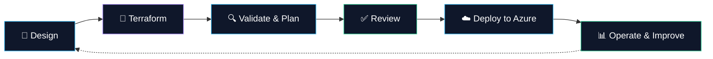

# 🌐 John Surender
### Cloud Engineer | Infrastructure Engineer | DevOps | Terraform | Azure

 

---

## 👋 About Me

Hi, I’m John — a Cloud, Infrastructure & DevOps Engineer specialising in Azure, Terraform, CI/CD automation and Infrastructure as Code.

I design and build scalable, secure cloud infrastructure with reusable modules, clear documentation and automated deployment pipelines.

My focus is on making infrastructure easier to deploy, understand and maintain — from the initial architecture through to day-to-day operations.

---

## 🚀 What I Do

- ☁️ Build and manage Azure cloud infrastructure.
- 🧱 Develop modular, reusable Terraform configurations.
- 🌍 Design infrastructure for dev, test and production environments.
- ⚙️ Automate validation and deployment with GitHub Actions.
- 🔀 Configure Azure App Service, CDN, Traffic Manager, DNS, Storage and VMs.
- 📐 Create architecture diagrams and practical technical documentation.
- 🔍 Troubleshoot deployments and optimise infrastructure.

---

## 🛠️ Technology Stack

 

| Area | Technologies |
| :--- | :--- |
| Cloud & Infrastructure | Microsoft Azure, Virtual Machines, Networking, DNS, Storage |
| Infrastructure as Code | Terraform, ARM Templates, Bicep |
| CI/CD & Automation | GitHub Actions, Azure DevOps |
| Scripting | Python, Bash |
| Tools & Platforms | Docker, Linux, Git |

---

## ⚙️ My Infrastructure Workflow

---

## 📦 Featured Project — BWO Cloud Infrastructure

An Azure infrastructure project built with Terraform, bringing together modular infrastructure, deployment automation and architecture documentation.

### Key Features

- 🧱 Modular Infrastructure as Code.
- ⚙️ CI/CD automation with GitHub Actions.
- 🔐 Remote Terraform state management.
- 🌐 Global routing and CDN configuration.
- 📐 Visual architecture documentation.

---

## 🎯 Engineering Principles

- Automate repeatable work.
- Keep infrastructure modular and maintainable.
- Review infrastructure changes before deployment.
- Document decisions, not just configurations.
- Design with security, reliability and clarity in mind.

---

## 📫 Let’s Connect

- LinkedIn: [John Surender](https://www.linkedin.com/in/john-surender/)
- GitHub: [@JohnSurender](https://github.com/JohnSurender)

### ☁️ Turning complex cloud problems into clear, repeatable infrastructure.

## 🛠️ Skills & Technologies

<table>
  <tr>
    <td><strong>Cloud</strong></td>
    <td>
      
      
    </td>
  </tr>

  <tr>
    <td><strong>Infrastructure as Code</strong></td>
    <td>
      
      
      
    </td>
  </tr>

  <tr>
    <td><strong>DevOps & CI/CD</strong></td>
    <td>
      
      
      
    </td>
  </tr>

  <tr>
    <td><strong>Languages</strong></td>
    <td>
      
      
      
    </td>
  </tr>

  <tr>
    <td><strong>Tools</strong></td>
    <td>
      
      
      
    </td>
  </tr>
</table>

🛠️ Tech Stack
Cloud: Azure
IaC: Terraform, ARM/Bicep
DevOps: GitHub Actions, Azure DevOps
Languages: Python, Bash
Tools: Docker, Linux, Git

📦 Featured Project
BWO Cloud Infrastructure
A complete production‑grade Azure architecture deployed with Terraform, featuring:

Modular IaC

CI/CD automation

Remote state management

Global routing + CDN

Full visual documentation suite

📫 Let’s Connect
LinkedIn: https://www.linkedin.com/in/john-surender/

GitHub: github.com/JohnSurender

⚡ Fun Fact
I love turning complex cloud problems into clean, elegant infrastructure.
